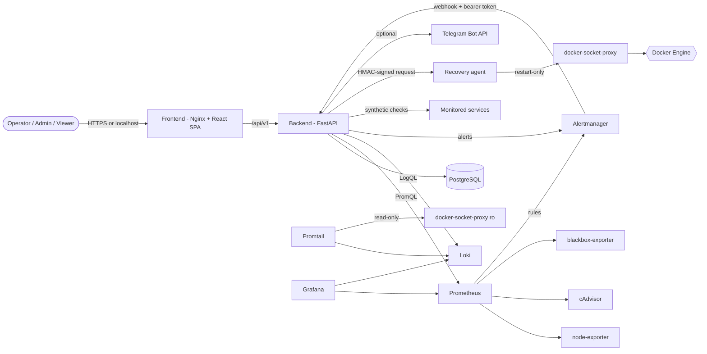

# IGuard - iGaming Infrastructure Guardian

> Monitor. Detect. Recover. Protect.

[](https://github.com/I-Guard/IGuard/actions/workflows/ci.yml)
[](https://github.com/I-Guard/IGuard/actions/workflows/security.yml)
[](LICENSE)


IGuard is an open-source monitoring and incident-response platform for iGaming-style infrastructure
(game APIs, wallet and authentication services, leaderboards). It collects host, container and
endpoint health, detects problems, deduplicates them into incidents, and can run **allowlisted,
audited recovery actions** - safely, with dry runs, cooldowns and circuit breakers.

Version 1.0.0 - Apache-2.0 - Maintainer: Matin Alijani (Matin.alijani@gmail.com)

## Features

- **Monitoring**: Prometheus, node-exporter, cAdvisor, blackbox-exporter, Loki + Promtail, Alertmanager,
  and 7 provisioned Grafana dashboards.
- **Incident engine**: fingerprinting, database-level deduplication, flapping detection, correlation,
  escalation, auto-resolve after consecutive healthy evaluations. Missing data never opens or clears an incident.
- **Recovery engine**: YAML allowlist of actions; no arbitrary commands; dry run required first;
  cooldowns, hourly limits, circuit breaker, idempotency keys; sensitive actions need ADMIN + explicit confirmation;
  databases and other critical targets are never auto-restarted. The backend never touches `docker.sock`;
  restarts go through a separate agent behind a restart-only socket proxy.
- **Dashboard** (React + TypeScript): 18 pages - overview, infrastructure, servers, services, incidents,
  recovery, history, logs explorer, alerts, reports, audit logs, users, settings, profile.
- **Security**: Argon2id, short-lived JWT access tokens, rotating refresh tokens with reuse detection,
  CSRF protection, RBAC (ADMIN / OPERATOR / VIEWER), rate limiting, lockout, audit log, secret redaction in logs.
- **Notifications**: optional Telegram through a transactional outbox with retry/backoff.

## Architecture



More detail: [docs/ARCHITECTURE.md](docs/ARCHITECTURE.md).

## Quick start (Docker)

Requires Docker with Compose v2.

```bash
git clone https://github.com/I-Guard/IGuard.git && cd IGuard
scripts/install.sh              # creates .env (mode 600) with random secrets
docker compose up -d --build
scripts/create-admin.sh         # prompts for the password
```

Open:

| What | URL |
| --- | --- |
| Dashboard | http://localhost:8080 |
| API docs (OpenAPI) | see note below (dev mode: http://localhost:8000/docs) |
| Grafana | http://localhost:3000 (user `admin`, password = `GRAFANA_ADMIN_PASSWORD` in `.env`) |

The OpenAPI UI is served by the backend container at `/docs`; the backend is not published to the host
by default. For local API exploration run the backend in dev mode (`make dev`, then http://localhost:8000/docs).

There are **no default credentials**. With `IGUARD_SEED_DEMO=true` the demo users
(`demo-admin`, `demo-operator`, `demo-viewer`) get random passwords printed once in the backend log
(`docker compose logs backend | grep "demo user"`), unless you set `IGUARD_SEED_PASSWORD`.
The five synthetic demo services (`game-api`, `game-web`, `wallet-mock`, `authentication-service`,
`leaderboard-service`) exist only to demonstrate detection and recovery; they are not real iGaming systems.

By default everything binds to `127.0.0.1`. Before exposing IGuard, read [docs/DEPLOYMENT.md](docs/DEPLOYMENT.md)
(TLS, `IGUARD_ENV=production`, secure cookies).

## Development

```bash
make install     # venv + npm ci
make dev         # backend :8000 (SQLite by default) + frontend :5173
make test        # pytest + vitest
make lint        # ruff, mypy, eslint, tsc
```

See [CONTRIBUTING.md](CONTRIBUTING.md) and [docs/DEVELOPMENT.md](docs/DEVELOPMENT.md).

## Documentation

[Architecture](docs/ARCHITECTURE.md) - [Installation](docs/INSTALLATION.md) - [Configuration](docs/CONFIGURATION.md) -
[API](docs/API.md) - [Security model](docs/SECURITY_MODEL.md) - [Monitoring](docs/MONITORING.md) -
[Incident engine](docs/INCIDENT_ENGINE.md) - [Recovery engine](docs/RECOVERY_ENGINE.md) -
[Notifications](docs/NOTIFICATIONS.md) - [Testing](docs/TESTING.md) - [Deployment](docs/DEPLOYMENT.md) -
[Operations](docs/OPERATIONS.md) - [Troubleshooting](docs/TROUBLESHOOTING.md) - [Development](docs/DEVELOPMENT.md) -
[Development status](docs/DEVELOPMENT_STATUS.md)

## Screenshots

Screenshots have not been captured yet. See [docs/screenshots/README.md](docs/screenshots/README.md);
nothing is shown here that was not produced by a real run.

## Verification status

What has and has not been executed in this repository is recorded honestly in
[docs/DEVELOPMENT_STATUS.md](docs/DEVELOPMENT_STATUS.md). In short: backend, frontend and browser
end-to-end tests have been run; Docker image builds and the full container stack have **not** been run yet.

## Security

Report vulnerabilities privately - see [SECURITY.md](SECURITY.md).

## License

Apache License 2.0 - see [LICENSE](LICENSE) and [NOTICE](NOTICE).
