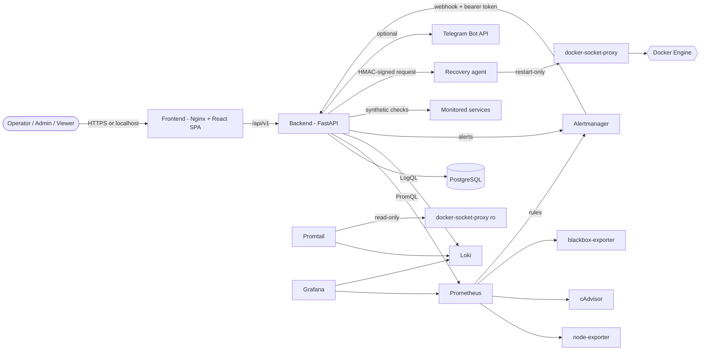
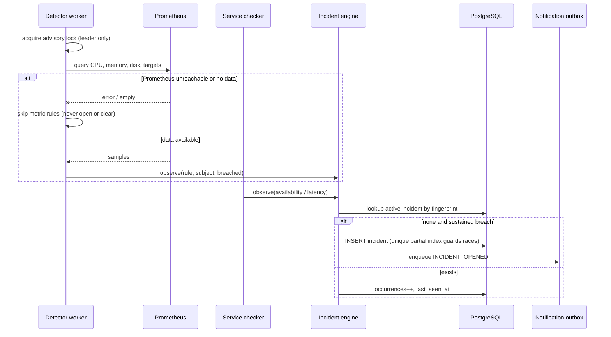
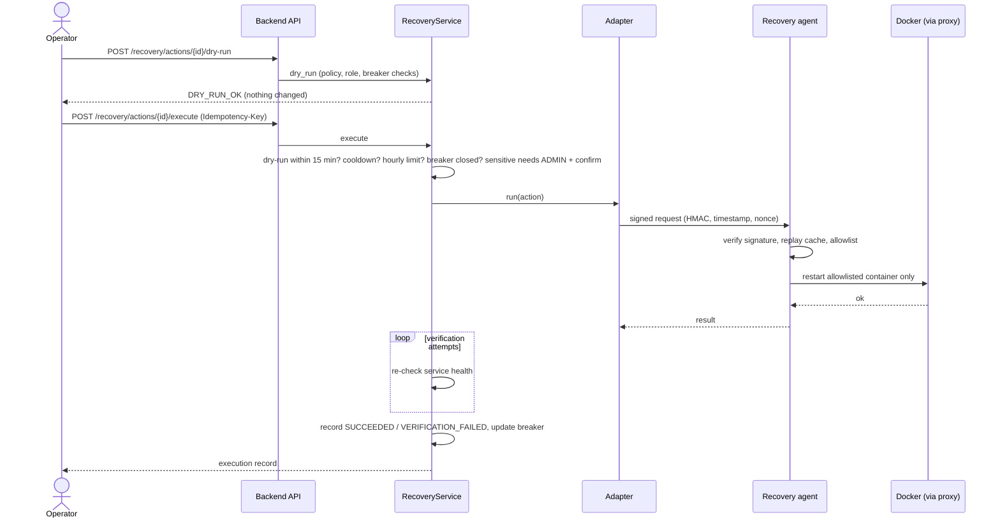
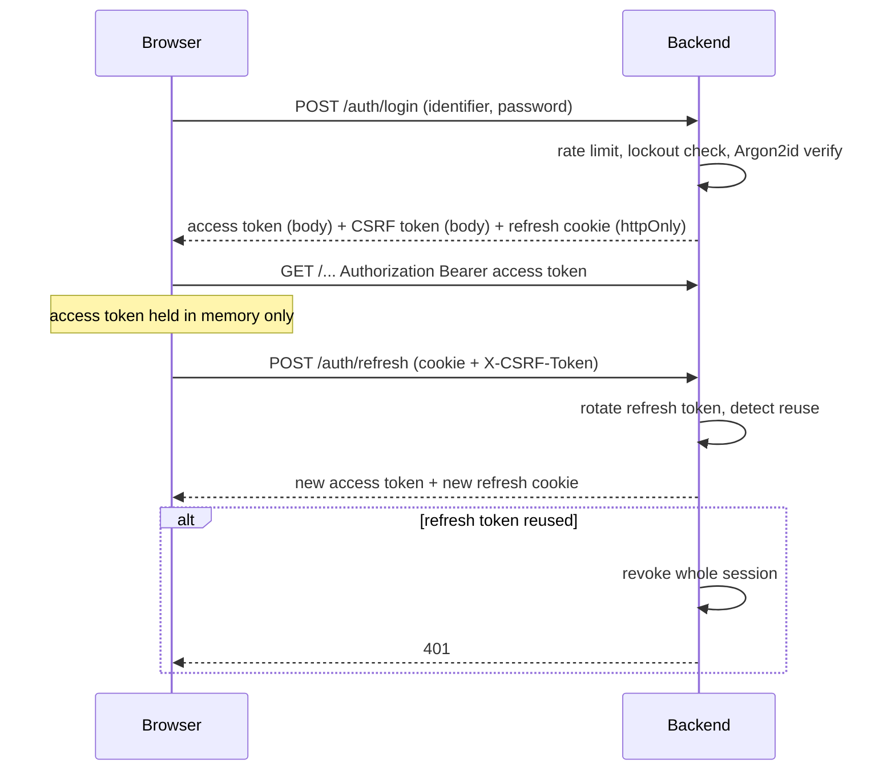
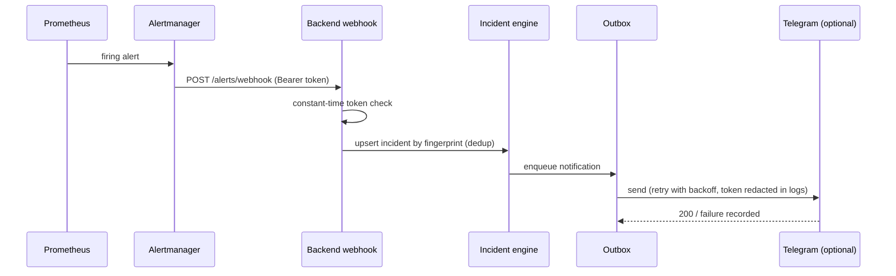
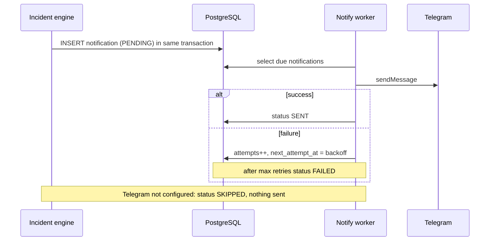

# Architecture

## Components

| Component | Role |
| --- | --- |
| Frontend | Nginx serving the React SPA; proxies `/api` to the backend; CSP, rate limits, JSON access log |
| Backend | FastAPI app (`/api/v1`), SQLAlchemy 2 + Alembic, background workers |
| PostgreSQL | System of record (incidents, services, checks, audit log, outbox, recovery executions) |
| Prometheus + exporters | Host (node-exporter), container (cAdvisor) and endpoint (blackbox) metrics; alert rules |
| Alertmanager | Routes alerts to the backend webhook (bearer token) |
| Loki + Promtail | Centralized container logs; Promtail reads Docker through a read-only socket proxy |
| Grafana | Seven provisioned dashboards (see MONITORING.md) |
| Recovery agent | Separate small service that executes allowlisted restarts/scripts for signed requests |
| docker-socket-proxy (x2) | One restart-only for the agent, one read-only for Promtail. The backend has no Docker access |
| Demo services | Five synthetic stdlib services used to demonstrate detection/recovery |

## Networks

`web` and `egress` are routable; `api`, `data`, `mon`, `apps` and `recovery` are internal. Only the
frontend (8080) and Grafana (3000) publish ports, bound to `127.0.0.1` by default.

## Backend layout (`backend/app`)

- `api/v1` routers - thin; authorization via dependencies in `security/deps.py`
- `services`, `repositories` - business logic and data access
- `incidents` - `engine.py` (lifecycle) and `detector.py` (signals from Prometheus and checks)
- `recovery` - policy loader, service (safety checks), adapters (agent / simulated)
- `monitoring` - Prometheus, Loki, Alertmanager clients and the service checker
- `notifications` - outbox dispatcher and Telegram client
- `workers/loops.py` - check, detection, notification and retention loops

## Workers

Workers run as threads inside the backend when `IGUARD_WORKERS_ENABLED=true`. Detection is leader-only,
guarded by a PostgreSQL advisory lock, so several backend replicas cannot double-detect.

## Data model

Users, roles, auth sessions and refresh tokens; servers; services and service checks; incidents and incident
events; recovery actions and executions; notifications and alert configuration; audit logs; system settings.
The initial schema is Alembic migration `0001`.

## Sequence diagrams

Incident detection, recovery execution, authentication, alert webhook and notification delivery:

### incident detection

### recovery

### auth

### alert webhook

### notification

